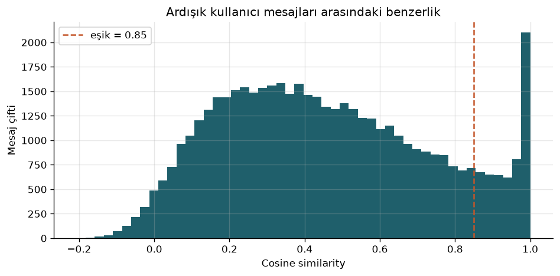
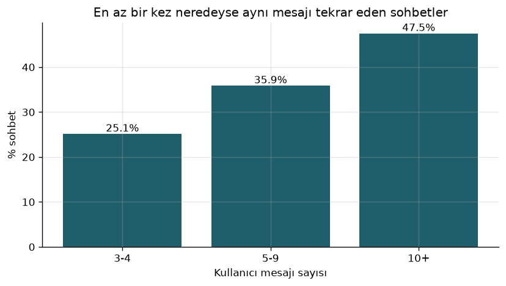
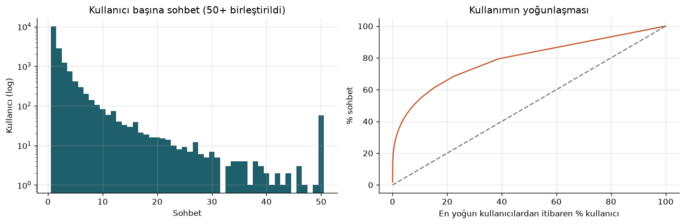
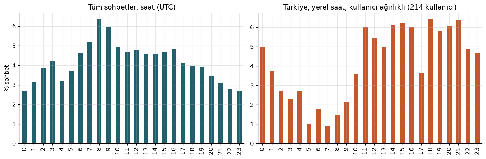

# SIC AI 18 Capstone Projesi, Grup 1

### Üretken yapay zeka kullanımında verimsiz döngülerin ve aşırı güvenin tespiti

Samsung Innovation Campus Yapay Zeka programının 18. dönem bitirme projesi. Bu yılın teması Yeşilay iş birliğiyle **dijital bağımlılık**.

---

## Proje hakkında

ChatGPT, Gemini ve Copilot gibi yapay zeka asistanları kısa sürede ders çalışmanın ve iş yapmanın sıradan bir parçası oldu. Bu araçlar verimliliği artırıyor, fakat yoğun kullanımla birlikte yeni bir alışkanlık da ortaya çıkıyor: aynı talebi tekrar tekrar sormak, cevabı defalarca yeniden ürettirmek ve düşünme işini giderek araca bırakmak. Oturum uzuyor, gerçek ilerleme duruyor.

Mevcut dijital iyi oluş araçları bu sorunu göremiyor, çünkü yalnızca **süreyi** ölçüyorlar. Oysa iki saatlik verimli bir çalışma ile iki saat boyunca aynı yerde dönmek arasındaki fark sürede değil, **kullanım biçiminde**.

Bu projede problemli yapay zeka kullanımını kullanım biçimi üzerinden tanımlıyor ve iki göstergeye odaklanıyoruz:

1. **Verimsiz kullanım döngüleri:** Aynı talebin neredeyse aynı şekilde tekrar gönderildiği, uzayan ama sonuca ulaşmayan sohbetler.
2. **Aşırı güven ve düşünme devri:** Üretimin ve kararın tamamen yapay zekaya bırakılması.

Hedeflediğimiz ürün, kullanıcının tarayıcısında çalışan bir **Chrome eklentisi**. Eklenti, açık kaynak sohbet verileriyle eğitilen bir model sayesinde bu örüntüleri kullanım sırasında fark ediyor ve yasak ya da süre sınırı koymak yerine doğru anda kısa, gerekçesini açıklayan bir yönlendirme sunuyor. Kullanıcının mesajları cihazından dışarı çıkmıyor.

**Hedef grup:** Günlük ders ve iş süreçlerinde üretken yapay zeka kullanan 18 ile 30 yaş arası yetişkinler, yani üniversite öğrencileri ve genç profesyoneller.

---


## Öne çıkan bulgular

WildChat 1M veri setinden alınan 50.000 gerçek ChatGPT sohbeti üzerinde yaptığımız analizin özeti. Ayrıntılar ve tüm grafikler [Bölüm 2: Veri Araştırması](docs/02_data_research.md) içinde.


| Bulgu                                                                                                            | Değer              |
| ---------------------------------------------------------------------------------------------------------------- | ------------------ |
| En az 3 turluk sohbetlerde, kullanıcının en az bir kez neredeyse aynı mesajı tekrar gönderdiği sohbetlerin oranı | **%31,6**          |
| Aynı oran 10 tur ve üzeri sohbetlerde                                                                            | **%47,5**          |
| En yoğun %1 kullanıcının toplam sohbetlerdeki payı                                                               | **%28,0**          |
| En yoğun %10 kullanıcının toplam sohbetlerdeki payı                                                              | **%54,1**          |
| Türkiye'den gelen sohbetlerde gece 00:00 ile 05:59 arası kullanım (sohbet bazında / kullanıcı ağırlıklı)         | **%30,7 / %17,5**  |
| Uzun sohbetlerde açık memnuniyetsizlik ifadelerinin kısa sohbetlere göre artışı                                  | **yaklaşık 7 kat** |
| Programlar tarafından otomatik gönderilen şablon sohbetlerin oranı                                               | **%16,5**          |


|                                                                                                                                                                                                             |                                                                                                                                                                                   |
| ----------------------------------------------------------------------------------------------------------------------------------------------------------------------------------------------------------- | --------------------------------------------------------------------------------------------------------------------------------------------------------------------------------- |
|  **Ardışık kullanıcı mesajlarının benzerliği.** 1,0'daki tepe, kullanıcının neredeyse aynı mesajı tekrar gönderdiği durumları gösteriyor. |  **Sohbet uzadıkça tekrar artıyor.** 10 tur ve üzeri sohbetlerin neredeyse yarısında en az bir tekrar var. |
|  **Kullanım az sayıda kişide toplanıyor.** Eğri ile kesikli çizgi arasındaki açıklık yoğunlaşmanın büyüklüğünü gösteriyor.                       |  **Günün saatlerine göre kullanım.** Sağda Türkiye, yerel saat ve kullanıcı ağırlıklı.                                       |


---


## Repo yapısı

```
SIC_AI_18_Capstone_Group_1/
├── README.md                     Projenin özeti, bulgular ve kullanım rehberi
├── requirements.txt              Analiz için gereken Python paketleri
├── .gitignore                    Sanal ortam, ham veri ve sistem dosyaları repo dışında
│
├── docs/                         Rapor bölümleri
│   ├── 01_literature_review.md
│   ├── 02_data_research.md
│   └── 03_technology_review.md
│
├── scripts/
│   └── run_eda.py                WildChat ve OASST1 keşifsel veri analizi
│
├── figures/                      Analizin ürettiği 10 grafik 
├── outputs/           
│   └── eda_summary.json          Analizdeki tüm sayıların makine tarafından okunabilir özeti
│
└── data/
    └── README.md                 Veri kaynakları ve lisanslar (ham veri repoya eklenmez)
```

---


## Veri setleri


| Veri seti                                                                    | İçerik                                                         | Projedeki rolü   | Erişim ve lisans           |
| ---------------------------------------------------------------------------- | -------------------------------------------------------------- | ---------------- | -------------------------- |
| [WildChat 1M](https://huggingface.co/datasets/allenai/WildChat-1M)           | Yaklaşık 838 bin gerçek ChatGPT sohbeti, 68 dil, zaman damgalı | Ana veri seti    | Açık erişim, ODC BY        |
| [LMSYS Chat 1M](https://huggingface.co/datasets/lmsys/lmsys-chat-1m)         | 25 farklı dil modeliyle 1 milyon gerçek sohbet                 | Genelleme testi  | Lisans sözleşmesi onayıyla |
| [OpenAssistant OASST1](https://huggingface.co/datasets/OpenAssistant/oasst1) | Yaklaşık 88 bin mesaj ve insanların verdiği kalite puanları    | Etiket referansı | Açık erişim, Apache 2.0    |


---


## Analizi çalıştırma

```bash
git clone https://github.com/edasaruhan/SIC_AI_18_Capstone_Group_1.git
cd SIC_AI_18_Capstone_Group_1

python3 -m venv .venv
source .venv/bin/activate
pip install -r requirements.txt
pip install sentence-transformers      # --embeddings seçeneği için

python scripts/run_eda.py --embeddings
```

**Ne olur?**

1. Script WildChat 1M'den sabit bir rastgelelik tohumuyla 50.000 sohbet, OASST1'den 30.000 mesaj okur. Aynı komut her seferinde aynı örneklemi ve aynı sonuçları üretir.
2. İndirilen örneklem `data/processed/` altına kaydedilir. İlk çalıştırma internet hızına göre 2 ile 5 dakika arasında sürer, sonraki çalıştırmalar veriyi yeniden indirmez.
3. Grafikler `figures/`, tüm sayılar `outputs/eda_summary.json` içine yazılır.

---

## Yaklaşımımızın ilkeleri

- **Yasak değil, yönlendirme.** Literatür, dışarıdan konan kısıtların etkisinin kalıcı olmadığını; doğru anda yapılan küçük yönlendirmelerin ise işe yaradığını gösteriyor.
- **Etiketleme değil, farkındalık.** Eklenti kimseye "bağımlısın" demez, teşhis koymaz; yalnızca kullanım biçimindeki örüntüyü görünür kılar.
- **Gizlilik öncelikli.** Model tarayıcıda çalışır, mesajlar saklanmaz ve hiçbir sunucuya gönderilmez.
- **Açıklanabilirlik.** Her uyarı nedenini söyler: "son 5 mesajda aynı talep".
- **Profesyonel desteğin yerini almaz.** Uzun süreli ve yoğun risk sinyallerinde kullanıcı Yeşilay Danışmanlık Merkezi'ne (YEDAM, 115) yönlendirilir.

---

