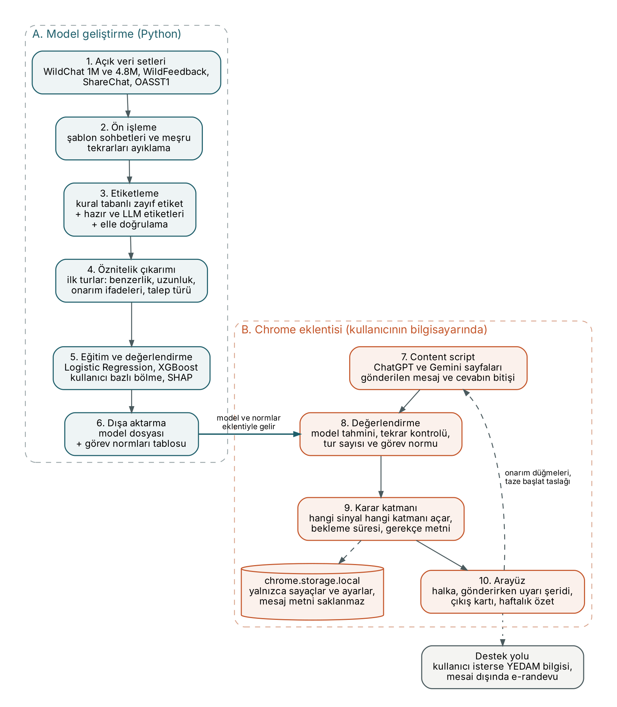
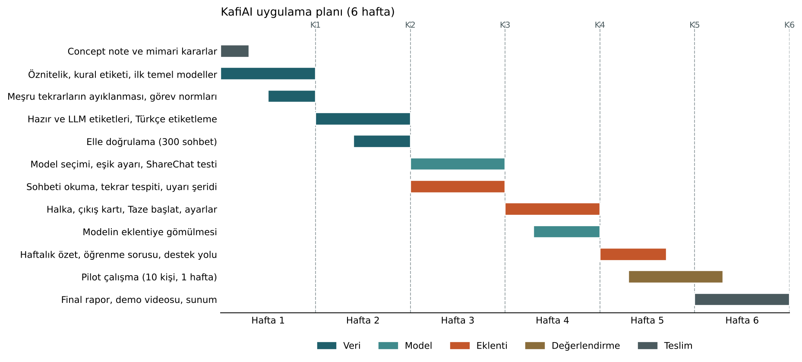

# Bölüm 4: Concept Note ve Uygulama Planı

**Proje adı:** KafiAI, üretken yapay zeka sohbetlerinde kısır döngüleri fark eden ve çıkış yolu sunan tarayıcı eklentisi
**Program:** Samsung Innovation Campus, Yapay Zeka 18. dönem, Grup 1 (UNDP Türkiye ve Yeşilay iş birliği)

Bu belge, önceki üç bölümde yaptığımız araştırmayı bir uygulama planına dönüştürüyor. Literatür, veri ve teknoloji tarafındaki ayrıntılar için ilgili bölümlere bağlantı verdik; burada kararlarımızı ve gerekçelerini özetliyoruz. Ürünün kullanıcıya nasıl görüneceği [Bölüm 6, Ürün kapsamı](06_product_scope.md) içinde ayrıntılı olarak anlatılıyor.

| Bölüm | Konu |
|---|---|
| [Bölüm 1](01_literature_review.md) | Literatür taraması |
| [Bölüm 2](02_data_research.md) | Veri araştırması |
| [Bölüm 3](03_technology_review.md) | Teknoloji incelemesi |
| Bölüm 4 (bu belge) | Concept note ve uygulama planı |
| [Bölüm 5](05_architecture_decisions.md) | Mimari kararlar |
| [Bölüm 6](06_product_scope.md) | Ürün kapsamı |
| [Bölüm 7](07_resources.md) | Veri setleri, kütüphaneler ve hazır kaynaklar |

---

# Concept Note

## 1. Projeye genel bakış (Project Overview)

ChatGPT ve Gemini gibi asistanlar üniversite öğrencilerinin ve genç çalışanların gündelik araçlarından biri haline geldi. Bu araçlar doğru kullanıldığında öğrenmeyi ve üretkenliği artırıyor. Fakat yoğun kullanımla birlikte iki sorunlu alışkanlık da görünür oluyor: aynı talebi defalarca gönderip sonuca ulaşamamak ve düşünme işini giderek tamamen araca bırakmak.

Bugünkü dijital iyi oluş araçları (Digital Wellbeing, Screen Time, one sec) süreye ve açılış sayısına bakıyor. İki saatlik verimli bir çalışma ile iki saat boyunca aynı yerde dönmek bu araçlar için aynı görünüyor. KafiAI bu farkı görmeyi hedefliyor. Kısaca: **ekran süresi değil, kısır döngü.**

**Çözümümüz:** ChatGPT ve Gemini'nin web arayüzünde çalışan bir Chrome eklentisi. Eklenti üç katmanda çalışıyor:

1. **Sakin gösterge.** Mesaj kutusunun kenarında küçük bir halka. Sohbet verimli giderken fark edilmez; döngü sinyalleri arttıkça rengi yavaşça değişir. Halkayı, açık veriyle eğitilmiş küçük bir model ile tur sayısı besler.
2. **Gönderirken yakalama.** Kullanıcı az önceki mesajlarından birine çok benzeyen bir mesaj göndermek üzereyse ince bir şerit çıkar: "Yine de gönder" ya da "Neyin eksik olduğunu söyle". Yanında hazır onarım düğmeleri bulunur: biçim yanlış, bilgi yanlış, fazla uzun ya da kısa.
3. **Çıkış yolu.** Döngü sürerse, cevap bittikten sonra kısa bir kart görünür. Kart, bu tür işlerin genelde kaç turda bittiğini söyler ve "Taze başlat" seçeneği sunar: kullanıcının o sohbetteki istekleri tek bir taslakta toplanır ve yeni bir sohbet açılır.

Bunlara ek olarak haftalık bir özet ve kullanıcı isterse adım adım ilerleyen bir destek yolu (Yeşilay Danışmanlık Merkezi, YEDAM) bulunuyor. Eklenti hiçbir şeyi engellemiyor, kimseye "bağımlısın" demiyor ve hiçbir mesajı cihazdan dışarı çıkarmıyor.

**Sustainable Development Goals (SDG) ile ilişkisi:**

| SDG | Target | Projedeki karşılığı |
|---|---|---|
| SDG 3, Good Health and Well-being | 3.4: mental health and well-being | Problemli kullanım örüntülerini erken fark etmek; kullanıcı isterse YEDAM'a kademeli yönlendirme |
| SDG 4, Quality Education | 4.4 ve 4.7: relevant skills for youth, education for sustainable development | Öğrencilerin yapay zekayı "koltuk değneği" yerine düşünmeyi destekleyen bir araç olarak kullanmasına yardımcı olmak |
| SDG 8, Decent Work and Economic Growth | 8.2: higher levels of economic productivity | Döngüde kaybedilen sürenin azaltılması |

**Beklenen etki:** Hedef grubumuz olan 18 ile 30 yaş arası kullanıcıların kendi kullanım biçimlerini görebilmesi, döngüde geçen sürenin azalması ve bu konuda Türkçe çalışan, gizliliği koruyan açık kaynak bir aracın ortaya çıkması.

## 2. Hedefler (Objectives)

Her hedefin yanında nasıl ölçüleceğini yazdık.

| # | Hedef | Ölçüt |
|---|---|---|
| H1 | Açık veri setlerinden "kısır döngü" etiketli bir eğitim seti oluşturmak | En az 3.000 etiketli sohbet; bunlardan 300'ünün (en az 100'ü Türkçe) elle doğrulanması; etiketleyiciler arası uyum (Cohen's kappa) en az 0,60 |
| H2 | Sohbetin ilk turlarına bakarak döngüye girme ihtimalini tahmin eden bir model geliştirmek | Kullanıcı bazlı ayrılmış test setinde PR-AUC değerinin hem rastgele tahminin hem de kural tabanlı yöntemin belirgin şekilde üzerinde olması |
| H3 | Her önerinin gerekçesini kullanıcıya gösterebilmek | Her şerit, kart ve halka açıklamasında kullanıcının anlayacağı dilde tek satırlık bir gerekçe bulunması |
| H4 | Her şeyi kullanıcının bilgisayarında çalıştırmak | Tek bir değerlendirmenin 150 ms altında sürmesi; eklentinin hiçbir ağ isteği yapmaması |
| H5 | Eklentiyi gerçek kullanıcılarla denemek | 10 gönüllüyle bir haftalık pilot; kart gösterildikten sonra bir sonraki mesajın tekrar olma oranındaki değişim; "bu öneri yerinde değildi" oranı; kısa kullanıcı anketi |

## 3. Arka plan (Background)

**Problem neden önemli?** Literatür, üretken yapay zekaya eleştirisiz güvenin eleştirel düşünmeyle negatif ilişkili olduğunu (Gerlich, 2025; Lee vd., 2025) ve bu etkinin en çok 17 ile 25 yaş grubunda görüldüğünü gösteriyor. Yaklaşık 1.000 lise öğrencisiyle yapılan bir saha deneyinde, kuralsız ChatGPT erişimi araç kaldırıldığında notları %17 düşürdü; öğrenmeyi koruyan yönergelerle tasarlanmış bir asistan ise bu kaybı büyük ölçüde önledi (Bastani vd., 2025). Kısacası sorun aracın kendisinde değil, nasıl kullanıldığında.

**Döngü yalnızca kullanıcının sorunu değil.** Dil modelleri de uzun sohbette zorlanıyor. 200 binden fazla simüle sohbet üzerinde yapılan bir çalışmada, önde gelen modellerin çok turlu sohbetlerde tek turlu kullanıma göre ortalama %39 daha düşük performans gösterdiği, sohbette yanlış bir yola saptıklarında da toparlanamadıkları görüldü (Laban vd., 2025). Bu bulgu ürünün dilini belirliyor: kullanıcıya "sen hata yapıyorsun" demek yerine "uzun sohbetlerde modeller yolunu kaybedebiliyor, taze başlamak genelde daha hızlı" diyebiliyoruz.

**Mevcut çözümler ve eksikleri:**

| Çözüm | Ne yapıyor | Eksik kalan |
|---|---|---|
| Digital Wellbeing, Screen Time | Uygulama başına süre ve sınır | Sohbetin içeriğini ve akışını göremiyor |
| one sec (Grüning vd., 2023) | Uygulama açılmadan önce kısa bir duraklama ve vazgeçme seçeneği | Süreye ve açılışa bakıyor, kullanım biçimine bakmıyor |
| ChatGPT mola hatırlatıcıları ve study mode (OpenAI, 2025) | Uzun oturumda mola önerisi, adım adım öğretim | Yalnızca ChatGPT içinde çalışıyor; doğru anda bu moda yönlendiren bir şey yok |
| Ai Habit Tracker gibi tarayıcı eklentileri | Kullanım sayacı, seri ve rozetler | Kullanımı azaltmak yerine oyunlaştırma ile artırma riski taşıyor |

**Neden makine öğrenmesi?** "Kısır döngü" tek bir kuralla tanımlanamıyor. Aynı talep farklı kelimelerle tekrar edilebiliyor; bazı uzun sohbetler ise tamamen verimli. Bölüm 2'deki analizimizde en az 3 turlu sohbetlerin %31,6'sında kullanıcının en az bir kez neredeyse aynı mesajı tekrar gönderdiğini gördük. Sohbet uzadıkça bu ihtimal doğal olarak arttığı için oranları ayrıca tur başına raporlayacağız. Döngüye girecek sohbeti erkenden sezmek için birden çok sinyali birlikte değerlendiren ve kararını açıklayabilen bir model gerekiyor.

## 4. Metodoloji (Methodology)

Projeyi beş adımda yürütüyoruz. Model tarafının kodu `src/kafiai` altında duruyor.

**Adım 1. Problemi bir tahmin görevine çevirmek.** Modelin görevi: kullanıcının ilk mesajlarına bakarak sohbetin bundan sonraki kısmında döngüye girip girmeyeceğini tahmin etmek. İlk sürümde model ilk iki mesajı görüyor; sonraki sürümde 3. ve 4. turlarda kararını güncelleyecek. Model sohbetin sonunu hiç görmediği için etiket bilgisi girdiye sızmıyor.

**Adım 2. Etiket üretmek.** Veri setlerinde hazır bir "döngü" etiketi yok. Etiketi üç katmanda üretiyoruz:

| Katman | Yöntem | Amaç |
|---|---|---|
| Kural tabanlı zayıf etiket | İkinci turdan sonra en az 2 kez neredeyse aynı mesaj (karakter benzerliği 0,75 üzeri) veya en az 2 onarım ifadesi ("olmadı", "tekrar", "that's not what I asked"). "Devam et" gibi kısa ve meşru tekrarlar ayıklanır. | Hızlı, şeffaf, tüm veriye uygulanabilir ilk etiket |
| LLM ile ölçütlü etiket | İngilizce sohbetler için Microsoft'un WildFeedback veri setindeki hazır tur bazlı memnuniyet ve memnuniyetsizlik etiketleri (GPT-4 ile Lin vd., 2024 yöntemiyle üretilmiş) kullanılır. Türkçe sohbetler için aynı ölçüt yaklaşık 1.000 sohbete bir dil modeliyle uygulanır. | Kuralların kaçırdığı anlam düzeyindeki tekrarları ve memnuniyetsizliği yakalamak |
| İnsan doğrulaması | 300 sohbet (en az 100'ü Türkçe) elle etiketlenir, kural ve LLM etiketleriyle karşılaştırılır | Etiket kalitesini sayıyla göstermek (Cohen's kappa) |

**Adım 3. Öznitelik çıkarımı.** İlk turlardan, her biri kullanıcıya açıklanabilecek 11 öznitelik hesaplıyoruz: mesajlar arası benzerlik, onarım ifadesi sayısı, mesaj uzunlukları ve oranı, kısa takip mesajı, ilk talebin türü (doğrudan üretim mi, anlama mı) ve kod içerip içermediği. Benzerlik için eğitim gerektirmeyen karakter n-gram vektörleri kullanıyoruz; aynı hesap tarayıcıda JavaScript ile birebir tekrarlanabiliyor. Sonraki sürümde yapay zekanın ilk cevabının uzunluğu ve "yeniden üret" tıklamaları gibi açık eylemler de eklenecek. Klavye tuşları hiçbir aşamada izlenmeyecek.

**Adım 4. Model ve değerlendirme.**

| Model | Neden |
|---|---|
| Kural tabanlı yöntem | Karşılaştırma tabanı; bir modelin işe yaraması için bunu geçmesi gerekir |
| Logistic Regression | En basit öğrenen model; katsayıları doğrudan yorumlanabilir ve küçük bir dosya olarak eklentiye konabilir |
| XGBoost | Tablo verisinde güçlü sonuç verir, SHAP ile her kararın gerekçesi gösterilebilir (Chen ve Guestrin, 2016; Lundberg ve Lee, 2017) |
| Çok dilli Transformer (MiniLM veya XLM-RoBERTa) | Yeterli etiket oluşursa son aşamada karşılaştırma için |

Değerlendirmede üç kurala uyuyoruz:

1. **Kullanıcı bazlı bölme.** Aynı kişinin sohbetleri hem eğitimde hem testte yer almaz (WildChat'teki şifrelenmiş IP ile gruplama).
2. **Dengesiz veriye uygun metrik.** Ana metrik PR-AUC; ayrıca precision, recall, F1 ve dil bazında yanlış uyarı oranı raporlanır.
3. **Genelleme testi.** ChatGPT verisiyle eğitilen model, Gemini, Claude ve Perplexity sohbetlerini de içeren ShareChat veri setinde ayrıca test edilir.

**İlk sonuçlar.** Veri hattını kurduk ve yalnızca kural tabanlı etiketle ilk denemeyi yaptık. WildChat örnekleminden şablon sohbetler çıkarıldıktan sonra en az 4 turlu 8.094 sohbet kaldı (4.693 kullanıcı). Bunların %11'i kural tabanlı etikete göre ikinci turdan sonra döngüye giriyor. Kullanıcı bazlı ayrılmış test setinde (1.543 sohbet) sonuçlar şöyle:

| Yöntem | PR-AUC | ROC-AUC | F1 |
|---|---|---|---|
| Rastgele tahmin | 0,095 | 0,50 | |
| Kural tabanlı yöntem | 0,191 | 0,658 | 0,364 |
| Logistic Regression | 0,264 | 0,703 | 0,324 |
| XGBoost | 0,243 | 0,699 | 0,291 |

Yalnızca ilk iki mesaja bakan basit modeller rastgele tahminin yaklaşık 2,8 katı PR-AUC'ye ulaşıyor ve kural tabanlı yöntemi geçiyor. En etkili öznitelikler ilk iki mesaj arasındaki benzerlik ve mesaj uzunlukları ([figures/13_feature_importance.png](../figures/13_feature_importance.png)). Bu sayılar bir başlangıç noktası; etiketler henüz yalnızca kurallardan geliyor. Kod: `scripts/build_dataset.py`, `scripts/train_baseline.py`; tüm sayılar `outputs/baseline_metrics.json` içinde.

**Adım 5. Tahmini tespitten ayırmak.** Döngü, henüz yazılmamış yapay zeka cevaplarına bağlı olduğu için tek bir sohbet hakkında erken tahminin isabeti sınırlı kalacak. Örneğin döngülerin %9,5 oranında görüldüğü bir ortamda, döngülerin yarısını yakalayıp normal sohbetlerin %90'ını rahat bırakan bir model bile verdiği her üç uyarıdan yaklaşık ikisinde yanılır. Bu yüzden ürünü modelin isabetine bağlamıyoruz:

| Sinyal | Kaynağı | Tetiklediği |
|---|---|---|
| Belirsiz erken tahmin | Model | Yalnızca halkanın renginde küçük bir değişim |
| Gerçekleşmiş tekrar | Kesin kural (benzerlik eşiği) | Gönderirken çıkan şerit ve onarım düğmeleri |
| Uzayan döngü | Tur sayısı ve görev normu | Çıkış kartı ve "Taze başlat" |
| Haftalık örüntü | Kesin sayımlar | Haftalık özet |

Böylece yanılma ihtimali olan sinyal yalnızca sakin bir göstergeyi etkiliyor; kullanıcının önüne çıkan öneriler ise olmuş bir şeye dayanıyor. Görev normları ("kod hatası sohbetlerinin çoğu 6 turda bitiyor") WildChat'teki talep türlerine göre ortanca tur sayısından hesaplanıyor ve yalnızca bu sınırı aşan kullanıcılara gösteriliyor.

## 5. Mimari tasarım (Architecture Design Diagram)

Sistem iki bölümden oluşuyor. Sol taraf modeli geliştirdiğimiz Python ortamı, sağ taraf kullanıcının bilgisayarında çalışan eklenti. İki taraf arasındaki tek bağlantı model ve görev normları dosyası; kullanıcı verisi hiçbir zaman sol tarafa gitmiyor.

| # | Bileşen | Görevi |
|---|---|---|
| 1 | Açık veri setleri | WildChat 1M ve 4.8M (ana veri), WildFeedback (hazır etiketler), ShareChat (genelleme testi), OASST1 (etiket referansı) |
| 2 | Ön işleme | Otomatik gönderilmiş şablon sohbetleri (%16,5) ayıklar, en az 4 turlu sohbetleri seçer |
| 3 | Etiketleme | Kural, LLM ve insan doğrulamasıyla "döngü" etiketini üretir |
| 4 | Öznitelik çıkarımı | İlk turlardan 11 açıklanabilir öznitelik hesaplar |
| 5 | Eğitim ve değerlendirme | Modelleri kullanıcı bazlı bölünmüş veride karşılaştırır, SHAP ile açıklar |
| 6 | Dışa aktarma | Seçilen modeli (katsayı dosyası veya ONNX) ve görev normları tablosunu eklentiye hazırlar |
| 7 | Content script | ChatGPT ve Gemini sayfalarında gönderilen mesajları ve cevabın bitişini okur |
| 8 | Değerlendirme | Aynı öznitelikleri hesaplar, modeli çalıştırır, tekrarı ve tur sayısını kontrol eder |
| 9 | Karar katmanı | Hangi sinyalin hangi katmanı tetikleyeceğini, iki öneri arasındaki bekleme süresini ve gerekçe metnini belirler |
| 10 | Arayüz | Halka, gönderirken uyarı şeridi, çıkış kartı ve haftalık özet; kullanıcı her öneriyi "yerinde değildi" diye işaretleyebilir |
| | Yerel depolama | Yalnızca sayaçlar ve ayarlar tutulur; mesaj metni saklanmaz |
| | Destek yolu | Kullanıcı isterse YEDAM bilgisi; mesai dışında telefon yerine e-randevu bağlantısı |

## 6. Veri kaynakları (Data Sources)

Ana veri setimiz **WildChat**: gerçek kullanıcıların ChatGPT ile yaptığı çok turlu sohbetler (ODC BY lisansı). Keşif analizini 838 bin sohbetlik WildChat 1M ile yaptık; model eğitiminde Ağustos 2025'e kadar uzanan ve GPT-4o dahil daha yeni modelleri içeren yaklaşık 3,2 milyon sohbetlik **WildChat 4.8M** sürümüne geçiyoruz. Bu sürüm hem daha güncel kullanımı temsil ediyor hem de çok daha fazla Türkçe sohbet sunuyor. Zaman damgası ve şifrelenmiş IP içerdiği için hem sohbet akışını hem kullanıcı düzeyindeki yoğunluğu inceleyebiliyoruz. Etiket kaynağı olarak WildChat üzerine kurulu **WildFeedback** (Shi vd., 2024; yaklaşık 1 milyon tur, ODC BY) veri setindeki hazır memnuniyetsizlik etiketlerini kullanıyoruz; bu etiketlere göre sohbetlerin yaklaşık %12'sinde kullanıcı memnuniyetsizliği görülüyor. Genelleme testi için **ShareChat** (142 bin sohbet; ChatGPT, Gemini, Claude, Grok ve Perplexity; CC BY-NC 4.0) ve gerekirse lisans onayıyla **LMSYS Chat 1M**; "iyi giden" ve "kötü giden" cevaplar için insan puanları içeren **OpenAssistant OASST1** kullanılacak. Ön işleme adımları: şablon sohbetlerin ve "devam et" gibi meşru tekrarların ayıklanması, en az 4 turlu sohbetlerin seçilmesi, çok uzun mesajların 1.000 karakterde kesilmesi ve verinin kullanıcı bazlı bölünmesi. Türkçe sohbet sayısı sınırlı olduğu için (50 bin sohbetlik örneklemde 402) elle hazırlanmış bir Türkçe test seti de oluşturacağız. Ayrıntılar: [Bölüm 2](02_data_research.md).

## 7. Literatür özeti (Literature Review)

Literatür üç noktada birleşiyor: üretken yapay zekaya eleştirisiz güven eleştirel düşünme ve öğrenme üzerinde ölçülebilir izler bırakıyor (Gerlich, 2025; Lee vd., 2025; Zhai vd., 2024); risk kullanım süresinden çok kullanım biçimiyle ilgili (Bastani vd., 2025; Fang vd., 2025); dışarıdan konan kısıtlar kalıcı olmazken doğru anda yapılan ve vazgeçme seçeneği sunan yönlendirmeler daha etkili (Okeke vd., 2018; Grüning vd., 2023). Uzun sohbetlerde modellerin kendisinin de yolunu kaybettiği gösterildi (Laban vd., 2025). "Yapay zeka bağımlılığı" kavramı ise tartışmalı (Ciudad-Fernández vd., 2025); bu yüzden kullanıcıyı etiketlemek yerine davranışa odaklanıyoruz. Çalışmaların büyük kısmı öz bildirime dayanıyor; sohbet verisinden otomatik tespit yapan en büyük çalışma (Phang vd., 2025) kamuya açık olmayan veri kullanıyor, davranış sinyallerini inceleyen yeni bir çalışma (Liu vd., 2026) ise gerçek zamanlı bir dedektör için verinin yetersiz kaldığını belirtiyor. KafiAI bu boşluğu açık veriyle eğitilen, kullanım sırasında çalışan ve kararını açıklayan bir araçla doldurmayı hedefliyor. Ayrıntılar: [Bölüm 1](01_literature_review.md).

---

# Uygulama Planı (Implementation Plan)

## 1. Teknoloji yığını (Technology Stack)

| Katman              | Teknoloji                                                                                                                        | Kullanım amacı                                            |
| ------------------- | -------------------------------------------------------------------------------------------------------------------------------- | --------------------------------------------------------- |
| Programlama dilleri | Python, JavaScript                                                                                                               | Model geliştirme; tarayıcı eklentisi                      |
| Veri                | Hugging Face Datasets, pandas, NumPy, PyArrow                                                                                    | Veri setlerine akış halinde erişim, tablo işlemleri       |
| Metin temsili       | scikit-learn HashingVectorizer, sentence-transformers (paraphrase-multilingual-MiniLM-L12-v2)                                    | Mesaj benzerliği; Türkçe dahil çok dilli anlam benzerliği |
| Modeller            | scikit-learn (Logistic Regression), XGBoost                                                                                      | Sınıflandırma                                             |
| Açıklanabilirlik    | SHAP                                                                                                                             | Her tahminin gerekçesi                                    |
| Etiketleme          | WildFeedback hazır etiketleri; Türkçe için bir LLM API'si (yalnızca açık veri setindeki metinler gönderilir); etiketleme tablosu | Ölçütlü etiket ve insan doğrulaması                       |
| Dışa aktarma        | JSON katsayı dosyası; ağaç modeli seçilirse ONNX ve ONNX Runtime Web                                                             | Modeli tarayıcıda çalışır hale getirmek                   |
| Eklenti             | Chrome Extension Manifest V3, chrome.storage.local                                                                               | Content script, karar katmanı, arayüz, yerel sayaçlar     |
| Geliştirme ortamı   | Git ve GitHub, VS Code, pytest, Jupyter, Docker                                                                                  | Sürüm kontrolü, test, deneyler                            |
| Donanım             | Kişisel bilgisayar                                                                                                               | Eğitim ve deneyler                                        |

## 2. Zaman çizelgesi (Timeline)

Çalışmayı program sonuna kadar altı haftaya böldük.

| Hafta | Aşama | Görevler |
|---|---|---|
| 1 | Planlama ve veri hattı | Concept note; mimari kararlar; öznitelik ve kural tabanlı etiket kodu; ilk temel modeller; etiketten meşru tekrarların ayıklanması; görev normları tablosu |
| 2 | Etiketleme | LLM değerlendirme ölçütünün yazılması; 3.000 sohbetin etiketlenmesi; 300 sohbetin elle doğrulanması; Türkçe test seti |
| 3 | Model ve eklenti iskeleti | Model seçimi ve eşik ayarı; ShareChat ile genelleme testi; eklentinin sohbeti okuması, tekrar tespiti ve gönderirken uyarı şeridi |
| 4 | Eklentinin çekirdeği | Halka, çıkış kartı ve "Taze başlat"; modelin eklentiye gömülmesi; ayarlar ve "yerinde değildi" düğmesi |
| 5 | Tamamlama ve pilot | Haftalık özet; öğrenme modu sorusu; kademeli destek yolu; gecikme testleri; 10 kişilik pilotun başlaması |
| 6 | Değerlendirme ve teslim | Pilot sonuçları; final rapor; demo videosu; sunum |

## 3. Kilometre taşları (Milestones)

| # | Kilometre taşı | Hafta | Tamamlanma ölçütü |
|---|---|---|---|
| K1 | Veri hattı çalışıyor | 1 | `scripts/build_dataset.py` ve `scripts/train_baseline.py` uçtan uca çalışıyor, testler geçiyor |
| K2 | Doğrulanmış etiket seti | 2 | 3.000 etiketli sohbet; 300 elle doğrulanmış; kappa en az 0,60 |
| K3 | Seçilmiş model ve çalışan şerit | 3 | Test setinde PR-AUC kural tabanlı yöntemin üzerinde; eklenti ChatGPT ve Gemini'de tekrarı yakalıyor |
| K4 | Eklentinin çekirdeği hazır | 4 | Halka, şerit ve çıkış kartı birlikte çalışıyor; tek değerlendirme 150 ms altında |
| K5 | Pilot başladı | 5 | 10 katılımcı eklentiyi kurdu; ilk iki gün yalnızca ölçüm, sonraki günler öneriler açık |
| K6 | Final teslim | 6 | Pilot sonuçları, rapor, kaynak kodu, demo videosu ve sunum repoda |

## 4. Etik değerlendirme (Ethical Considerations)

| Konu | Yaklaşımımız |
|---|---|
| Veri gizliliği | Mesajlar cihazda işlenir, saklanmaz ve hiçbir sunucuya gönderilmez. Eklentinin kodunda ağ isteği yoktur ve yalnızca iki siteye erişim izni ister. Yerelde yalnızca sayaçlar tutulur; kullanıcı tüm veriyi tek tuşla silebilir. Kod açık kaynaktır. |
| Klavye ve davranış izleme | Tuş vuruşları izlenmez; yalnızca gönderilen mesajlar ve cevabın bitişi okunur. |
| Açık veri setleri | Lisans koşullarına uyulur. Ham veri repoya eklenmez; raporda tek bir kişiye ait mesaj, örnek sohbet veya şifrelenmiş IP yer almaz. |
| LLM ile etiketleme | Dil modeline yalnızca kamuya açık veri setlerindeki metinler gönderilir; pilot katılımcılarının verisi hiçbir zaman gönderilmez. |
| Pilot çalışma ve KVKK | Katılımcılar 18 ile 30 yaş arası, yapay zekayı ders veya iş için kullanan gönüllülerdir. Kısa bir aydınlatma metni sunulur ve yazılı açık rıza alınır. Mesaj içeriği toplanmaz; yalnızca özet sayaçlar ve anket cevapları toplanır. Katılımcı istediği an çıkabilir. |
| Etiketleme ve damgalama | Eklenti kimseye "bağımlısın" demez, teşhis koymaz, puan vermez. Ekranda "risk" kelimesi kullanılmaz. Tek bir sohbete bakılarak destek yönlendirmesi yapılmaz. |
| Duygusal kullanım | Kişisel ve duygusal sohbetlerde verimlilik önerileri gösterilmez. Eklenti duygusal bağımlılığı ölçtüğünü iddia etmez. |
| Gözetim riski | Ebeveyn ya da işveren modu yoktur; eklenti yalnızca kullanıcının kendisine geri bildirim verir. Bir kurum tarafından kurulduğunu fark ederse kullanıcıya hiçbir verinin kuruma gitmediğini açıkça söyler. |
| Ürünün kendisinin yeni bir alışkanlığa dönüşmesi | Seri, puan ve rozet kullanılmaz. Kullanıcı ilerledikçe önerilerin sıklığı azalır. |
| Profesyonel destek | Eklenti terapi ya da danışmanlık sunmaz. Destek yolu kademelidir ve kullanıcının isteğine bağlıdır; mesai dışında telefon yerine YEDAM e-randevu bağlantısı gösterilir. |

## 5. Kaynakça (References, APA 7)

Bastani, H., Bastani, O., Sungu, A., Ge, H., Kabakcı, Ö., & Mariman, R. (2025). Generative AI without guardrails can harm learning: Evidence from high school mathematics. *Proceedings of the National Academy of Sciences, 122*, e2422633122. https://doi.org/10.1073/pnas.2422633122

Chen, T., & Guestrin, C. (2016). XGBoost: A scalable tree boosting system. In *Proceedings of the 22nd ACM SIGKDD International Conference on Knowledge Discovery and Data Mining* (pp. 785–794). https://doi.org/10.1145/2939672.2939785

Ciudad-Fernández, V., von Hammerstein, C., & Billieux, J. (2025). People are not becoming "AIholic": Questioning the "ChatGPT addiction" construct. *Addictive Behaviors, 166*, Article 108325. https://doi.org/10.1016/j.addbeh.2025.108325

Fang, C. M., Liu, A. R., Danry, V., Lee, E., Chan, S. W. T., Pataranutaporn, P., Maes, P., Phang, J., Lampe, M., Ahmad, L., & Agarwal, S. (2025). *How AI and human behaviors shape psychosocial effects of extended chatbot use: A longitudinal randomized controlled study* (arXiv:2503.17473). https://doi.org/10.48550/arXiv.2503.17473

Gerlich, M. (2025). AI tools in society: Impacts on cognitive offloading and the future of critical thinking. *Societies, 15*(1), Article 6. https://doi.org/10.3390/soc15010006

Grüning, D. J., Riedel, F., & Lorenz-Spreen, P. (2023). Directing smartphone use through the self-nudge app one sec. *Proceedings of the National Academy of Sciences, 120*, e2213114120. https://doi.org/10.1073/pnas.2213114120

Laban, P., Hayashi, H., Zhou, Y., & Neville, J. (2025). *LLMs get lost in multi-turn conversation* (arXiv:2505.06120). https://arxiv.org/abs/2505.06120

Lee, H. P., Sarkar, A., Tankelevitch, L., Drosos, I., Rintel, S., Banks, R., & Wilson, N. (2025). The impact of generative AI on critical thinking: Self-reported reductions in cognitive effort and confidence effects from a survey of knowledge workers. In *Proceedings of the 2025 CHI Conference on Human Factors in Computing Systems*. https://doi.org/10.1145/3706598.3713778

Lin, Y. C., Neville, J., Stokes, J. W., Yang, L., Safavi, T., Wan, M., Counts, S., Suri, S., Andersen, R., Xu, X., Gupta, D., Jauhar, S. K., Song, X., Buscher, G., Tiwary, S., Hecht, B., & Teevan, J. (2024). Interpretable user satisfaction estimation for conversational systems with large language models. In *Proceedings of the 62nd Annual Meeting of the Association for Computational Linguistics* (pp. 11100–11115). https://aclanthology.org/2024.acl-long.598/

Liu, C., Zhou, Q., Shen, X., Liu, X. B., Wu, T., & Chen, X. A. (2026). *Behavioral indicators of overreliance during interaction with conversational language models* (arXiv:2602.11567). https://arxiv.org/abs/2602.11567

Lundberg, S. M., & Lee, S. I. (2017). A unified approach to interpreting model predictions. In *Advances in Neural Information Processing Systems 30* (pp. 4765–4774).

Okeke, F., Sobolev, M., Dell, N., & Estrin, D. (2018). Good vibrations: Can a digital nudge reduce digital overload? In *Proceedings of MobileHCI '18*. https://doi.org/10.1145/3229434.3229463

OpenAI. (2025, August 4). *What we're optimizing ChatGPT for*. https://openai.com/index/optimizing-chatgpt/

Phang, J., Lampe, M., Ahmad, L., Agarwal, S., Fang, C. M., Liu, A. R., Danry, V., Lee, E., Chan, S. W. T., Pataranutaporn, P., & Maes, P. (2025). *Investigating affective use and emotional well-being on ChatGPT* (arXiv:2504.03888). https://doi.org/10.48550/arXiv.2504.03888

Shi, T., Wang, Z., Yang, L., Lin, Y. C., He, Z., Wan, M., Zhou, P., Jauhar, S., Chen, S., Xia, S., Zhang, H., Zhao, J., Xu, X., Song, X., & Neville, J. (2024). *WildFeedback: Aligning LLMs with in-situ user interactions and feedback* (arXiv:2408.15549). https://huggingface.co/datasets/microsoft/WildFeedback

Yan, Y., Nguyen, T., Su, B., Lieffers, M., & Le, T. (2025). *ShareChat: A dataset of chatbot conversations in the wild* (arXiv:2512.17843). https://arxiv.org/abs/2512.17843

Yeşilay Danışmanlık Merkezi. (2026). *Teknoloji bağımlılığı*. https://www.yedam.org.tr/bagimlilik-turleri/teknoloji-bagimliligi

Zhai, C., Wibowo, S., & Li, L. D. (2024). The effects of over-reliance on AI dialogue systems on students' cognitive abilities: A systematic review. *Smart Learning Environments, 11*, Article 28. https://doi.org/10.1186/s40561-024-00316-7

Zhao, W., Ren, X., Hessel, J., Cardie, C., Choi, Y., & Deng, Y. (2024). WildChat: 1M ChatGPT interaction logs in the wild. In *International Conference on Learning Representations (ICLR 2024)*. https://huggingface.co/datasets/allenai/WildChat-1M
